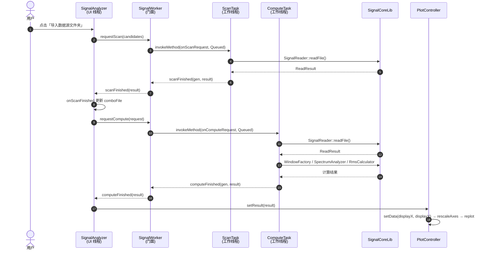

# SignalAnalyzer 调用流程说明

> 从「界面点击」到「文件读取 → 信号计算 → 曲线展示」的完整关键函数调用链。
> 依据当前代码整理（目录已按 `include/` + `src/` 拆分）。

---

## 0. 总览

### 0.1 组件与线程

| 组件 | 所在线程 | 职责 |
|---|---|---|
| `SignalAnalyzer` | UI 线程 | 交互入口、状态栏、下拉框、结果转交绘图 |
| `SignalWorker` | UI 线程（门面） | 持有工作线程与两个代际号，过滤过期结果 |
| `ComputeTask` | 工作线程 | 读取 + 计算 |
| `ScanTask` | 工作线程 | 批量轻量校验文件（不查坏行） |
| `PlotController` | UI 线程 | 降采样并写入 QCustomPlot |
| `SignalCoreLib` | 无 Qt 依赖 | 纯算法：读取、窗函数、FFT、频谱、RMS |

> 说明：`ComputeTask` 与 `ScanTask` 都通过 `moveToThread(&m_workerThread)` 放在**同一个**常驻工作线程，因此实际是串行执行；拆分的是职责与代际号，不是线程。

### 0.2 全局时序



### 0.3 阶段划分

| 阶段 | 触发 | 关键落点 |
|---|---|---|
| 一、启动与装配 | `main()` | `SignalAnalyzer` / `SignalWorker` 构造 |
| 二、导入文件夹（扫描） | 按钮 `clicked` | `onImportFolder` → `ScanTask::onScanRequest` → `onScanFinished` |
| 三、发起计算 | 下拉框变化 | `onFileChanged` / `onSignalChanged` / `onWindowChanged` → `requestCompute` |
| 四、读取与解析 | 工作线程 | `ComputeTask::onComputeRequest` → `SignalReader::readFile/parse` |
| 五、信号计算 | 工作线程 | `WindowFactory::create` → `SpectrumAnalyzer` / 时域拼装 → `RmsCalculator` |
| 六、回传与绘图 | UI 线程 | `onComputeFinished` → `PlotController::setResult` → `QCustomPlot` |
| 七、失败与丢弃 | 任意阶段 | `isStale` 静默丢弃 / `ok=false` 清图报错 |

---

## 1. 阶段一：启动与组件装配

### 1.1 调用链

```
main()
└─ QApplication app(argc, argv)
└─ SignalAnalyzer window
   └─ SignalAnalyzer::SignalAnalyzer()
      ├─ ui.setupUi(this)
      ├─ m_worker        = std::make_unique<SignalWorker>()
      │  └─ SignalWorker::SignalWorker()
      │     ├─ qRegisterMetaType<ComputeRequest / ComputeResult / ScanResult>()
      │     ├─ new ComputeTask(m_computeGeneration)
      │     ├─ new ScanTask(m_scanGeneration)
      │     ├─ ComputeTask::moveToThread(&m_workerThread)
      │     ├─ ScanTask::moveToThread(&m_workerThread)
      │     ├─ connect(QThread::finished → QObject::deleteLater)   // 生命周期
      │     ├─ connect(ComputeTask::computeFinished → SignalWorker::onImplComputeFinished)
      │     ├─ connect(ScanTask::scanFinished       → SignalWorker::onImplScanFinished)
      │     └─ m_workerThread.start()
      ├─ m_plotController = std::make_unique<PlotController>(ui.plot)
      ├─ setupCombos()                                  // 信号类型 / 窗函数选项
      ├─ connect(界面控件 → 槽函数)                        // 见 1.2
      ├─ connect(m_worker → onComputeFinished / onScanFinished)
      ├─ ui.plot->setInteraction(iRangeDrag/iRangeZoom)
      ├─ ui.plot->addGraph()、图例、坐标轴标签
      └─ m_plotController->clear()
└─ window.show()
└─ app.exec()
```

### 1.2 信号槽连接（入口表）

| 发送者 | 信号 | 接收槽 |
|---|---|---|
| `ui.btnImportFolder` | `QPushButton::clicked` | `SignalAnalyzer::onImportFolder` |
| `ui.comboFile` | `currentIndexChanged(int)` | `SignalAnalyzer::onFileChanged` |
| `ui.comboSignal` | `currentIndexChanged(int)` | `SignalAnalyzer::onSignalChanged` |
| `ui.comboWindow` | `currentIndexChanged(int)` | `SignalAnalyzer::onWindowChanged` |
| `SignalWorker` | `computeFinished(ComputeResult)` | `SignalAnalyzer::onComputeFinished` |
| `SignalWorker` | `scanFinished(ScanResult)` | `SignalAnalyzer::onScanFinished` |

---

## 2. 阶段二：导入文件夹（UI → 扫描任务 → UI）

### 2.1 调用链

```
用户点击「导入数据源文件夹」
└─ QPushButton::clicked
   └─ SignalAnalyzer::onImportFolder()
      ├─ QFileDialog::getExistingDirectory(this, ..., m_dataFolder 或 homePath)
      ├─ [切换文件夹时，替换语义]
      │  ├─ ui.comboFile->blockSignals(true)
      │  ├─ ui.comboFile->clear()
      │  ├─ ui.comboFile->blockSignals(false)
      │  ├─ m_importedPaths.clear() / m_keyByPath.clear() / m_currentPath.clear()
      │  └─ m_plotController->clear()
      ├─ QDir(dir).entryInfoList({"*.txt"}, QDir::Files, QDir::Name)
      ├─ for each QFileInfo：
      │  ├─ path = fi.absoluteFilePath()
      │  ├─ key  = fileKey(fi)                    // 文件名|大小|修改时间
      │  ├─ m_keyByPath.find(path)
      │  │  ├─ 命中且 key 相同  → ++duplicates（跳过）
      │  │  ├─ 命中且 key 不同  → 刷新签名，++updated（复用条目）
      │  │  └─ 未命中          → candidates << path（新文件）
      ├─ m_pendingDuplicates / m_pendingUpdated / m_pendingCurrentUpdate
      ├─ candidates 为空 → statusBar 提示（必要时 requestCompute）
      └─ m_worker->requestScan(candidates)
         └─ SignalWorker::requestScan()
            ├─ gen = ++(*m_scanGeneration)         // 只递增扫描代际号
            └─ QMetaObject::invokeMethod(m_scanTask, "onScanRequest",
                                         Qt::QueuedConnection,
                                         Q_ARG(QStringList, paths),
                                         Q_ARG(quint64, gen))
```

### 2.2 工作线程执行

```
[工作线程事件循环]
└─ ScanTask::onScanRequest(paths, generation)
   ├─ for each path：
   │  ├─ if (isStale(generation)) return;          // 被更新的扫描取代则静默放弃
   │  ├─ path.toLocal8Bit() → SignalReader::probeFile(const char*)
   │  │     // 轻量校验：只读首行 fs + 找到第一行非空数据行即返回，
   │  │     // 不逐行解析数值、不检测坏行（坏行留到实际计算时的 readFile/parse 判定）
   │  ├─ ok   → validPaths << path
   │  └─ !ok  → classify(probe.error)：
   │              "fs"                     → skippedMissingFs++
   │              "no valid data rows"     → skippedEmpty++
   │              "empty file"             → skippedEmpty++
   │              其他                      → skippedEmpty++
   └─ emit scanFinished(generation, result)
      └─ SignalWorker::onImplScanFinished(generation, result)
         ├─ if (generation != 最新扫描代际号) return;   // 兜底过滤
         └─ emit scanFinished(result)
```

### 2.3 回到 UI 线程

```
SignalAnalyzer::onScanFinished(result)
├─ firstNewIndex = ui.comboFile->count()
├─ for each validPath：
│  ├─ m_importedPaths << path
│  ├─ m_keyByPath.insert(path, fileKey(fi))
│  └─ ui.comboFile->addItem(fi.fileName())
├─ 组装状态栏：「新增 N / M 个文件内容已更新 / 跳过 K 个重复…」
├─ added > 0 → ui.comboFile->setCurrentIndex(firstNewIndex)
│  └─ 触发 currentIndexChanged(int) → onFileChanged(index) → requestCompute()   // 进入阶段三
├─ added == 0 且当前无选中 → setCurrentIndex(0)
└─ m_pendingCurrentUpdate && added == 0 → requestCompute()（当前文件被修改后刷新）
```

> 注意：首次导入时下拉框为空，`addItem` 添加第一条会自动把当前下标置为 0 并发出 `currentIndexChanged(0)`，从而提前触发一次计算；随后 `setCurrentIndex(0)` 因下标未变不会再发信号。

---

## 3. 阶段三：发起计算（UI → 计算任务）

### 3.1 三条触发路径

```
① 切换文件
   ui.comboFile::currentIndexChanged(int)
   └─ SignalAnalyzer::onFileChanged(index)
      ├─ index 越界 → m_currentPath.clear(); m_plotController->clear(); return
      └─ m_currentPath = m_importedPaths[index]; requestCompute()

② 切换信号类型
   ui.comboSignal::currentIndexChanged(int)
   └─ SignalAnalyzer::onSignalChanged(index)
      └─ m_currentPath 非空 → requestCompute()

③ 切换窗函数
   ui.comboWindow::currentIndexChanged(int)
   └─ SignalAnalyzer::onWindowChanged(index)
      └─ m_currentPath 非空 → requestCompute()
```

### 3.2 统一出口

```
SignalAnalyzer::requestCompute()
├─ if (m_currentPath.isEmpty()) return
├─ ComputeRequest request
│  ├─ filePath   = m_currentPath
│  ├─ signalType = currentSignalType()      // comboSignal 下标 → SignalType
│  └─ windowName = currentWindowName()      // comboWindow userData："rect"/"hann"
└─ m_worker->requestCompute(request)
   └─ SignalWorker::requestCompute()
      ├─ gen = ++(*m_computeGeneration)     // 只递增计算代际号
      └─ QMetaObject::invokeMethod(m_computeTask, "onComputeRequest",
                                   Qt::QueuedConnection,
                                   Q_ARG(ComputeRequest, request),
                                   Q_ARG(quint64, gen))
```

---

## 4. 阶段四：读取与解析（工作线程 + SignalCoreLib）

```
[工作线程事件循环]
└─ ComputeTask::onComputeRequest(request, generation)
   ├─ if (isStale(generation)) return
   ├─ SignalReader::readFile(path)
   │  ├─ std::ifstream 打开（失败 → "cannot open file: ..."）
   │  ├─ ss << in.rdbuf()                       // 整个文件读入内存
   │  └─ SignalReader::parse(text)
   │     ├─ std::getline 读取首行
   │     ├─ parseSampleRate(line)
   │     │  ├─ 按 ',' 切段 → 段内按空白切 token
   │     │  ├─ key == "fs" → std::strtod → 返回采样率
   │     │  └─ 缺失/非法   → nullopt → error = "missing or invalid fs metadata"
   │     ├─ 逐行：getline → trim
   │     │  ├─ 空行 → 跳过（不占位）
   │     │  ├─ strtod 失败/非有限值 → ++skipped（坏行占位）
   │     │  └─ 成功 → 记录有效样本（值 + 非空行序号）
   │     ├─ 有效样本为空 → error = "no valid data rows"
   │     ├─ 坏行 → 前后有效样本线性插值填补，保持时间轴等间隔
   │     └─ SignalData(fs, std::move(samples))
   ├─ !read.ok → result.error = 错误文本 → emit computeFinished(...) → return
   ├─ result.fs / pointCount / skippedLines 赋值
   └─ 进入阶段五
```

> `SignalReader` 是纯静态函数、无共享状态，因此可安全地在工作线程调用。

---

## 5. 阶段五：信号计算（SignalCoreLib）

```
ComputeTask::onComputeRequest(...) 续
├─ WindowFactory::create(windowName)
│  ├─ "rect" → RectWindow（等效不加窗，correctionFactor = 1）
│  └─ "hann" → HannWindow（correctionFactor = 2）
│
├─ 时域分支（SignalType::TimeDomain）
│  ├─ n = data.size()
│  ├─ xs[i] = i / data.sampleRate()
│  ├─ ys[i] = data.at(i)
│  ├─ 每 65536 点检查 isStale(generation)   // 协作式取消
│  └─ fftSize = 0
│
├─ 频谱分支（AmplitudeSpectrum / PowerSpectrum）
│  └─ SpectrumAnalyzer::amplitudeSpectrum(data, window) 或 powerSpectrum(...)
│     └─ computeSpectrum(data, window, power)
│        ├─ nFft = nextPowerOfTwo(nRaw)
│        ├─ 零填充构造 Fft::Complex 缓冲，填入 data.at(i)
│        ├─ 若 window != nullptr：
│        │  ├─ 取实部 → window->apply(realPart) → 回填缓冲
│        │  └─ correction = window->correctionFactor()
│        ├─ Fft::forward(buf)
│        ├─ frequencies = frequencyAxis(fs, nFft)     // k = 0..nFft/2
│        ├─ 归一化：DC/Nyquist 用 mag/nFft，其余用 2*mag/nFft，再乘 correction
│        └─ power == true → magnitudes 存 norm*norm（自功率谱）
│  ├─ result.fftSize = nextPowerOfTwo(data.size())
│  ├─ 从 k = 1 起找 magnitudes 最大值 → peakFreq / peakMag（排除 DC）
│  ├─ xs = std::move(spectrum.frequencies)
│  └─ ys = std::move(spectrum.magnitudes)
│
├─ RmsCalculator::compute(data.samples())      // sqrt(Σx² / N)
├─ if (isStale(generation)) return              // 结果过期不上屏
├─ result.x / result.y = make_shared<vector>(std::move(xs/ys))
│                                              // 全量数据用共享指针，跨线程零拷贝
├─ downsampleForDisplay(*x, *y, displayX, displayY)
│                                              // 显示数据在本线程降采样（ComputeTask 内部函数）
└─ emit computeFinished(generation, result)
```

---

## 6. 阶段六：结果回传与绘图（UI 线程）

```
SignalWorker::onImplComputeFinished(generation, result)
├─ if (generation != 最新计算代际号) return      // 兜底过滤
└─ emit computeFinished(result)
   └─ SignalAnalyzer::onComputeFinished(result)
      ├─ !result.ok
      │  ├─ m_plotController->clear()
      │  └─ statusBar：「解析失败：<error>」
      └─ ok
         ├─ m_plotController->setResult(result)
         │  ├─ graph(0)->setName(graphNameFor(signalType))
         │  ├─ graph(0)->setData(result.displayX, result.displayY)  // 已降采样，不再搬运全量
         │  ├─ xAxis->setLabel(时间 (s) / 频率 (Hz))
         │  ├─ yAxis->setLabel(幅值 / 功率)
         │  ├─ rescaleAxes()
         │  └─ replot()
         └─ statusBar：fs / N / FFT / RMS（频谱再追加谱峰与窗函数、坏行数）
```

---

## 7. 阶段七：失败与丢弃路径

| 场景 | 发生位置 | 行为 |
|---|---|---|
| 文件打不开 / 缺 `fs` / 无有效行 | `SignalReader::parse` | `read.ok=false`，UI 清图并在状态栏显示原因 |
| 扫描中又发起了新的导入 | `ScanTask::onScanRequest` 的 `isStale` | 旧扫描静默退出，不发 `scanFinished` |
| 计算未完成又发起新计算 | `ComputeTask::onComputeRequest` 的 `isStale` | 旧计算在读取后/循环中/发射前退出，不上屏 |
| 结果投递后才过时 | `SignalWorker::onImplComputeFinished/ScanFinished` | 代际号比对失败，丢弃 |
| 当前无选中文件 | `onFileChanged` 越界分支 | 清空路径与绘图区 |

> `isStale` 只与**同类任务**的代际号比较：计算代际号 `m_computeGeneration` 与扫描代际号 `m_scanGeneration` 相互独立，因此“切窗函数”不会打断“导入扫描”，反之亦然。

---

## 8. 关键函数索引

| 阶段 | 函数 | 文件 |
|---|---|---|
| 启动 | `main` | `SignalAnalyzer/src/main.cpp` |
| 启动 | `SignalAnalyzer::SignalAnalyzer` / `setupCombos` | `SignalAnalyzer/src/SignalAnalyzer.cpp` |
| 启动 | `SignalWorker::SignalWorker` | `SignalAnalyzer/src/SignalWorker.cpp` |
| 导入 | `SignalAnalyzer::onImportFolder` | `SignalAnalyzer/src/SignalAnalyzer.cpp` |
| 导入 | `fileKey`（匿名命名空间） | `SignalAnalyzer/src/SignalAnalyzer.cpp` |
| 导入 | `SignalWorker::requestScan` | `SignalAnalyzer/src/SignalWorker.cpp` |
| 扫描 | `ScanTask::onScanRequest` / `isStale` / `classify` | `SignalAnalyzer/src/ScanTask.cpp` |
| 导入 | `SignalAnalyzer::onScanFinished` | `SignalAnalyzer/src/SignalAnalyzer.cpp` |
| 计算触发 | `onFileChanged` / `onSignalChanged` / `onWindowChanged` / `requestCompute` | `SignalAnalyzer/src/SignalAnalyzer.cpp` |
| 计算触发 | `SignalWorker::requestCompute` | `SignalAnalyzer/src/SignalWorker.cpp` |
| 读取 | `ComputeTask::onComputeRequest` | `SignalAnalyzer/src/ComputeTask.cpp` |
| 读取 | `SignalReader::readFile` / `parse` / `parseSampleRate` | `SignalCoreLib/src/SignalReader.cpp` |
| 计算 | `WindowFactory::create` | `SignalCoreLib/src/WindowFactory.cpp` |
| 计算 | `SpectrumAnalyzer::amplitudeSpectrum/powerSpectrum/computeSpectrum` | `SignalCoreLib/src/SpectrumAnalyzer.cpp` |
| 计算 | `Fft::forward` | `SignalCoreLib/src/Fft.cpp` |
| 计算 | `RmsCalculator::compute` | `SignalCoreLib/include/SignalCoreLib/RmsCalculator.h` |
| 展示 | `SignalWorker::onImplComputeFinished` | `SignalAnalyzer/src/SignalWorker.cpp` |
| 展示 | `SignalAnalyzer::onComputeFinished` | `SignalAnalyzer/src/SignalAnalyzer.cpp` |
| 计算 | `PlotDownsampler::extract`（工作线程降采样） | `SignalAnalyzer/include/PlotDownsampler.h` |
| 展示 | `PlotController::setResult` / `clear` | `SignalAnalyzer/src/PlotController.cpp` |

---

## 9. 线程与代际号小结

- **线程边界**：UI 线程（`SignalAnalyzer` / `SignalWorker` / `PlotController`）与工作线程（`ComputeTask` / `ScanTask`）之间只通过 `QueuedConnection` 的信号/`invokeMethod` 通信，参数类型均已 `qRegisterMetaType`。
- **两个代际号**：
  - `m_computeGeneration`：`requestCompute` 自增，`ComputeTask` 内部与门面回传时比对；
  - `m_scanGeneration`：`requestScan` 自增，`ScanTask` 内部与门面回传时比对。
- **效果**：计算只取消旧计算，扫描只取消旧扫描；“切换信号类型/窗函数”不会再丢弃正在进行的导入扫描。
- **生命周期**：`ComputeTask`/`ScanTask` 无 parent，`moveToThread` 后由 `QThread::finished → QObject::deleteLater` 在工作线程销毁；`SignalWorker` 析构只做 `quit()` + `wait()`。
