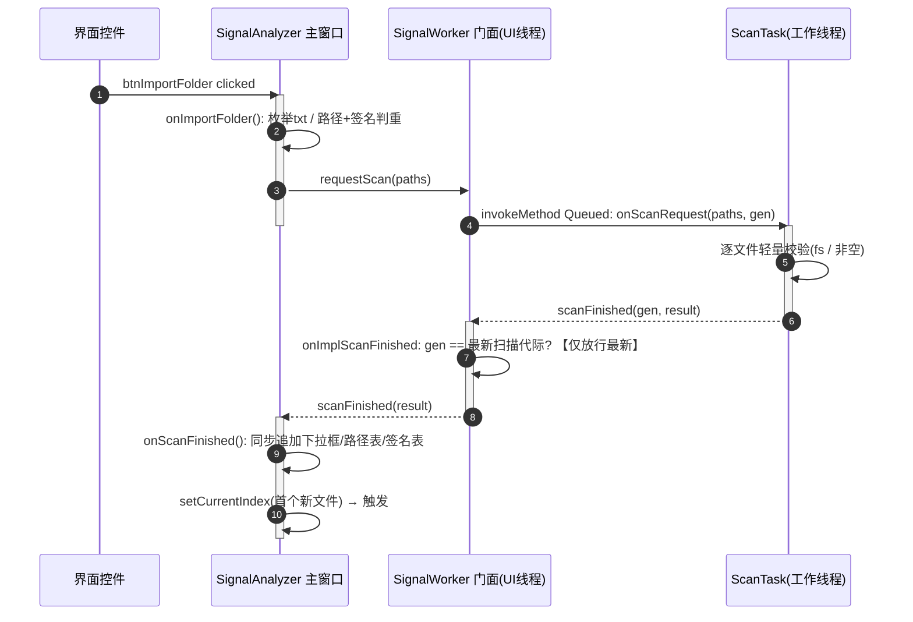
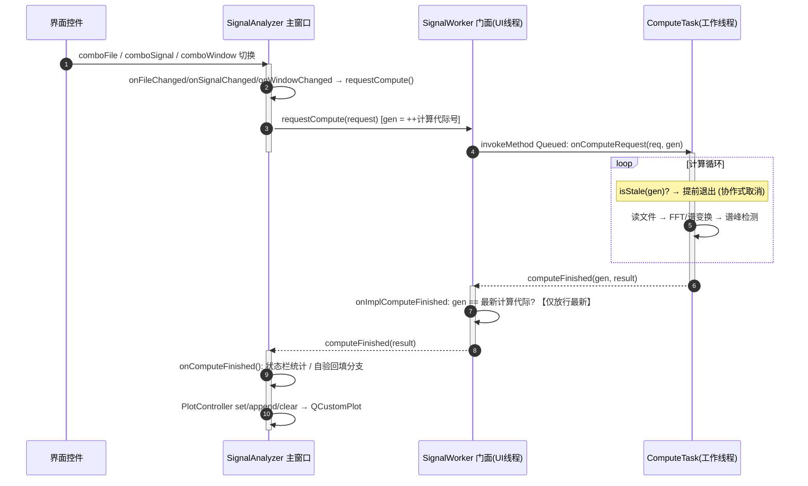
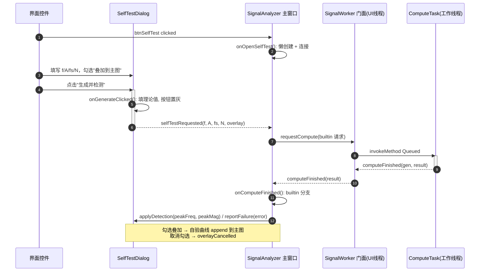
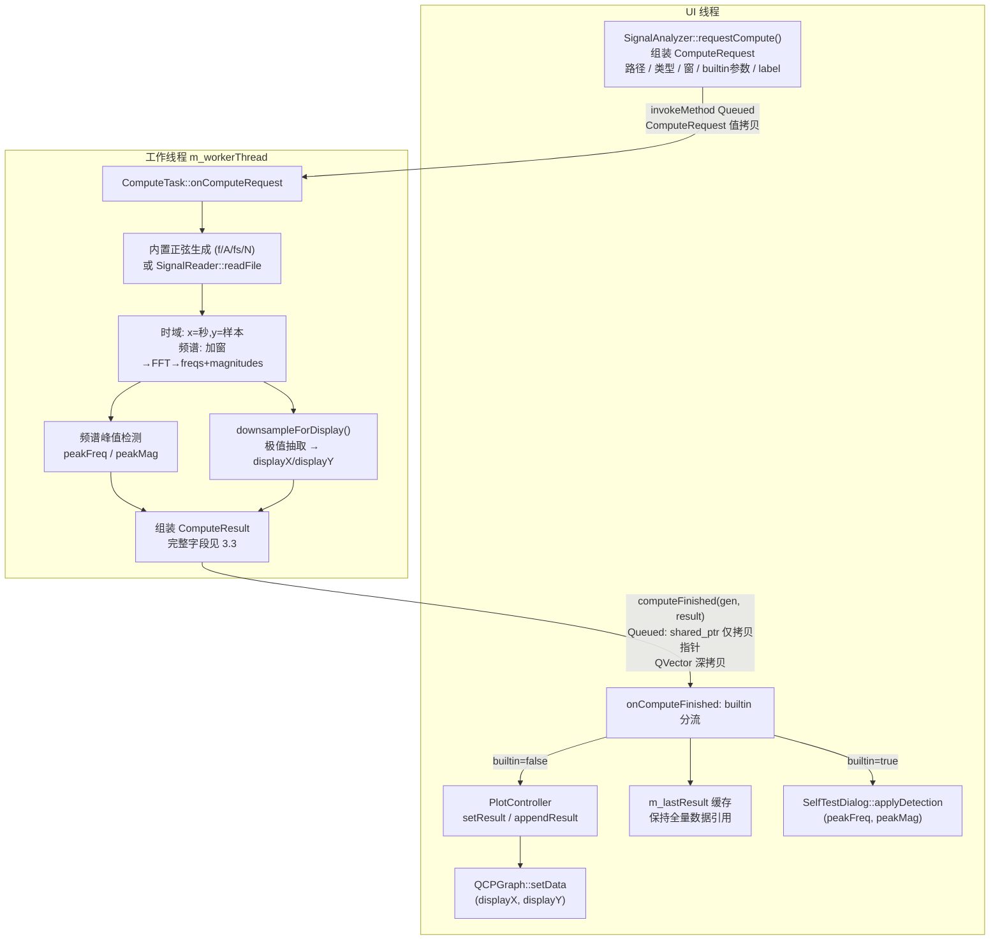

# SignalAnalyzer 项目信号传递梳理

> 本文档梳理 SignalAnalyzer 应用中**全部信号槽连接**与数据传递路径，
> 覆盖主窗口（SignalAnalyzer）、后台门面（SignalWorker）、任务对象（ComputeTask / ScanTask）
> 与自验对话框（SelfTestDialog）四个模块之间的信号依赖关系。
>
> 范围：`SignalAnalyzer` 应用层（界面 + 协调器），不含纯算法库 `SignalCoreLib` 的内部调用。

---

## 1. 信号槽连接总表

### 1.1 用户交互 → SignalAnalyzer 槽（UI 线程内，直接连接）

均在 [SignalAnalyzer 构造函数](file:///c:/Users/work/Desktop/qt-demo-cmake/SignalAnalyzer-cmake/SignalAnalyzer/src/SignalAnalyzer.cpp#L75-L132) 中完成：

| # | 信号（发送者） | 槽（接收者） | 触发时机 |
|---|---|---|---|
| 1 | `QPushButton::clicked`（`btnImportFolder`） | `SignalAnalyzer::onImportFolder()` | 点击「导入数据源文件夹」 |
| 2 | `QComboBox::currentIndexChanged(int)`（`comboFile`） | `SignalAnalyzer::onFileChanged(int)` | 切换被选文件 |
| 3 | `QComboBox::currentIndexChanged(int)`（`comboSignal`） | `SignalAnalyzer::onSignalChanged(int)` | 切换信号类型（时域/幅值谱/自功率谱） |
| 4 | `QComboBox::currentIndexChanged(int)`（`comboWindow`） | `SignalAnalyzer::onWindowChanged(int)` | 切换窗函数 |
| 5 | `QPushButton::clicked`（`btnClearCurves`） | `SignalAnalyzer::onClearCurves()` | 点击「清空曲线」 |
| 6 | `QPushButton::clicked`（`btnSelfTest`） | `SignalAnalyzer::onOpenSelfTest()` | 点击「自验」 |
| 7 | `QCheckBox::toggled(bool)`（`chkOverlay`） | `SignalAnalyzer::onOverlayToggled(bool)` | 勾选/取消「叠加对比」 |
| 8 | `QSpinBox::valueChanged(int)`（`spinPointLimit`） | `SignalAnalyzer::onPointLimitChanged(int)` | 修改「显示点数」 |

### 1.2 SignalWorker → SignalAnalyzer 槽（UI 线程内）

| # | 信号（发送者） | 槽（接收者） | 说明 |
|---|---|---|---|
| 9 | `SignalWorker::computeFinished(const ComputeResult&)` | `SignalAnalyzer::onComputeFinished(const ComputeResult&)` | 后台计算结果回传（**已过代际号过滤**） |
| 10 | `SignalWorker::scanFinished(const ScanResult&)` | `SignalAnalyzer::onScanFinished(const ScanResult&)` | 后台扫描结果回传（**已过代际号过滤**） |

> `SignalWorker` 对象本身位于 UI 线程（由主窗口构造），因此 9/10 是**同线程直接连接**；
> 真正的计算跑在 `m_workerThread` 中，结果经门面过滤后**转发**到 UI 线程。

### 1.3 SignalWorker 内部（跨线程 / 生命周期）

在 [SignalWorker 构造函数](file:///c:/Users/work/Desktop/qt-demo-cmake/SignalAnalyzer-cmake/SignalAnalyzer/src/SignalWorker.cpp#L9-L36) 中建立：

| # | 信号（发送者） | 槽/方法（接收者） | 连接类型 | 用途 |
|---|---|---|---|---|
| 11 | `QThread::finished`（`m_workerThread`） | `ComputeTask::deleteLater()` | 直连 | 线程退出后在工作线程内销毁计算任务 |
| 12 | `QThread::finished`（`m_workerThread`） | `ScanTask::deleteLater()` | 直连 | 线程退出后在工作线程内销毁扫描任务 |
| 13 | `ComputeTask::computeFinished(quint64, const ComputeResult&)` | `SignalWorker::onImplComputeFinished(...)` | **跨线程 Queued** | 计算结果先回门面做代际号过滤 |
| 14 | `ScanTask::scanFinished(quint64, const ScanResult&)` | `SignalWorker::onImplScanFinished(...)` | **跨线程 Queued** | 扫描结果先回门面做代际号过滤 |

### 1.4 门面→任务：`QMetaObject::invokeMethod` Queued 调用（非 connect，但构成请求通道）

| # | 入口 | 目标 | 调用方式 | 用途 |
|---|---|---|---|---|
| 15 | `SignalWorker::requestCompute()` | `ComputeTask::onComputeRequest(request, generation)` | `invokeMethod(..., Qt::QueuedConnection, Q_ARG...)` | 异步投递计算请求（跨线程） |
| 16 | `SignalWorker::requestScan()` | `ScanTask::onScanRequest(paths, generation)` | `invokeMethod(..., Qt::QueuedConnection, Q_ARG...)` | 异步投递扫描请求（跨线程） |

### 1.5 SelfTestDialog 相关的信号（懒连接）

在 [onOpenSelfTest](file:///c:/Users/work/Desktop/qt-demo-cmake/SignalAnalyzer-cmake/SignalAnalyzer/src/SignalAnalyzer.cpp#L470-L483) 中建立（对话框首次打开时才连接）：

| # | 信号（发送者） | 槽（接收者） | 说明 |
|---|---|---|---|
| 17 | `SelfTestDialog::selfTestRequested(double f, double A, double fs, int n, bool overlay)` | `SignalAnalyzer::onSelfTestRequested(...)` | 点击「生成并检测」 |
| 18 | `SelfTestDialog::overlayCancelled()` | `SignalAnalyzer::onSelfTestOverlayCancelled()` | 取消「叠加到主图」勾选 |

对话框**内部**（[SelfTestDialog 构造函数](file:///c:/Users/work/Desktop/qt-demo-cmake/SignalAnalyzer-cmake/SignalAnalyzer/src/SelfTestDialog.cpp#L99-L108)）：

| # | 信号 | 槽/表达式 | 说明 |
|---|---|---|---|
| 19 | `QPushButton::clicked`（`m_generateBtn`） | `SelfTestDialog::onGenerateClicked()` | 内部触发 + emit `selfTestRequested`（#17） |
| 20 | `QCheckBox::toggled(bool)`（`m_overlayCheck`） | lambda | 取消勾选时 emit `overlayCancelled`（#18） |

回填是**方法调用**（非信号）：主窗口 `onComputeFinished` 收到 `builtin==true` 的结果后，
直接调用 `m_selfTestDialog->applyDetection(peakFreq, peakMag)` 或 `reportFailure(error)`。

---

## 2. 信号流向总图（Mermaid 时序图）

下面三张时序图分别对应**导入 / 计算 / 自验**三条主链路。箭头语义约定：
- **实线箭头（`->`）**：同线程直接调用或 DirectConnection 信号；
- **虚线箭头（`-->`）**：跨线程信号（QueuedConnection）或异步回传；
- **标注 `invokeMethod Queued`**：UI→工作线程投递请求（[§1.4](#14-门面任务qmetaobjectinvokemethod-queued-调用非-connect但构成请求通道)）；
- 括号 `【仅放行最新】` 表示该信号的发出经过了代际号过滤（[§4.3](#43-代际号双闸过滤信号链路上的安检门)）。

### 图 2-1：导入链路



### 图 2-2：计算链路



### 图 2-3：自验链路



---

## 3. 数据流转图（数据面）

> 第 2 章梳理的是**控制面**（信号/槽在模块间怎么走）；本章切换到**数据面**——
> 具体的数据对象（`ComputeRequest` / `SignalData` / `ComputeResult` / `ScanResult`）在哪里被创建、
> 如何被转换、以何种方式跨线程传递、最终被谁消费。

### 3.1 一次计算的完整数据流（Mermaid flowchart）



### 3.2 数据对象一览

| 数据对象 | 创建者 | 内容 | 共享范围 |
|---|---|---|---|
| `ComputeRequest` | UI 线程 `requestCompute()` | 文件路径、类型、窗名、builtin 参数（f/A/fs/N）、图例 label | 仅任务调用的临时值对象 |
| `SignalData`（库内） | 工作线程 `ComputeTask` | `fs` + 幅值序列 `samples` | 工作线程内临时对象 |
| `ComputeResult` | 工作线程 `ComputeTask` | 见 [SignalTypes.h](file:///c:/Users/work/Desktop/qt-demo-cmake/SignalAnalyzer-cmake/SignalAnalyzer/include/SignalTypes.h#L30-L62) | UI 线程 + 工作线程往返 |
| `ScanResult` | 工作线程 `ScanTask` | `validPaths` + 两类跳过计数 | UI 线程 |
| `QVector` 显示数组 | 工作线程降采样 | `displayX/displayY`（≤ ~2×50000 点） | UI 线程绘图 |

### 3.3 ComputeResult 字段的数据面语义

| 字段组 | 字段 | 数据面说明 |
|---|---|---|
| 全量曲线 | `x` / `y` | `shared_ptr<const vector<double>>`，**跨线程零拷贝**（Queued 只复制指针）；时域 x=秒、y=样本；频谱 x=Hz、y=幅值/功率 |
| 显示曲线 | `displayX` / `displayY` | 工作线程内**预降采样**（[ComputeTask.cpp](file:///c:/Users/work/Desktop/qt-demo-cmake/SignalAnalyzer-cmake/SignalAnalyzer/src/ComputeTask.cpp#L23-L31)），UI 线程直接 `setData`，不在 UI 重采样 |
| 统计量 | `fs` `pointCount` `fftSize` `rms` `peakFreq` `peakMag` | 标量值随结果拷贝，供状态栏 / 自验表格 |
| 属性 | `ok` `error` `skippedLines` `builtin` `label` `generation` | 语义开关 / 图例 / 代际号兜底 |

### 3.4 数据所有权与生命周期

| 数据 | 谁创建 | 何时释放 |
|---|---|---|
| `x/y` 全量数据 | 工作线程 | 随 `shared_ptr` 引用计数：UI 侧 `m_lastResult` 保活；被下一次结果替换或 `clear` 时释放 |
| `displayX/displayY` | 工作线程（降采样） | Queued 投递时**深拷贝**一份到事件队列 → `QCPGraph::setData` 所在的 QCP 内部容器；原对象随 `ComputeResult` 结束释放 |
| `ComputeRequest` | UI 栈上 | `invokeMethod` Queued 时**值拷贝**进队列，工作线程消费后销毁 |

### 3.5 数据面与控制面对照

- **控制面（信号）**关心消息「走不走到、顺序如何」→ 见第 2 章的时序图；
- **数据面（本图）**关心数据「怎么变、怎么传、谁持有内存」→ 本章的 flowchart；
- 两者共同点：都以 `ComputeResult` 为一次计算的「完成里程碑」，且都受代际号闸门约束。

---

## 4. 关键机制说明

### 4.1 入口/出口统一

- **入口统一**：任何「影响计算结果」的界面变化（文件/类型/窗函数/自验）最终都收敛到
  `requestCompute()` → `SignalWorker::requestCompute()`（唯一向后台投递计算请求的路径）。
- **出口统一**：所有计算结果只经 `SignalWorker::computeFinished` 一个信号回到 UI，
  UI 只消费这一个信号 + 一个 `scanFinished`。

### 4.2 跨线程通信的两类手段

| 手段 | 场景 | 线程模型 |
|---|---|---|
| `QMetaObject::invokeMethod(..., Qt::QueuedConnection)` | UI→任务投递请求（#15/#16） | UI 线程调用，任务槽在工作线程执行 |
| `connect(..., Qt::QueuedConnection)`（自动按线程判定） | 任务→门面回传（#13/#14） | 任务在工作线程 emit，门面槽在 UI 线程执行 |
| 直接 `connect`（同线程，默认 AutoConnection=Direct） | UI 控件↔主窗口、主窗口↔worker（#1-#10） | 全部 UI 线程内 |

> 跨线程传递的 `ComputeResult` / `ScanResult` / `ComputeRequest` 均为**注册过的元类型**
> （`qRegisterMetaType`，见 [SignalWorker.cpp](file:///c:/Users/work/Desktop/qt-demo-cmake/SignalAnalyzer-cmake/SignalAnalyzer/src/SignalWorker.cpp#L15-L17)），
> 可被 Queued connection 安全拷贝。`ComputeResult` 内部数组用 `shared_ptr<const vector<double>>`，
> Queued 投递只拷贝指针，**数据零拷贝**跨线程。

### 4.3 代际号双闸过滤（信号链路上的「安检门」）

```
UI 线程                               工作线程
requestCompute()                    ComputeTask::onComputeRequest
  gen = ++(*m_computeGeneration)       ├─ isStale(gen)？→ 过期直接 return（协作式取消）
  invokeMethod(...gen...)  ──────▶    └─ 计算 → emit computeFinished(gen, result)
                                                          │ (Queued 回到 UI 线程)
信号最终放行条件（onImplComputeFinished）：
  generation == m_computeGeneration->load()  ── 相同才 emit computeFinished（对外）
```

- 「计算」与「扫描」使用**两个独立代际号**，切换信号类型不会打断导入扫描，反之亦然；
- 任务层在计算循环中通过 `isStale()` 做**协作式取消**（提前退出）；
- 门面层在回传前再做一次**兜底过滤**，保证 UI 永远只收到最新一次请求的结果。
- 因此，用户快速连点切换时，绝不可能出现"旧结果后到覆盖新结果"。

### 4.4 生命周期信号（#11/#12）

`m_workerThread.finished` → `deleteLater` 是 Qt worker-object 的标准生命周期写法：
对象在哪个线程执行槽，就在哪个线程销毁（跨线程 delete 属未定义行为），
同时确保线程退出时把尚未执行的排队请求安全清理。

### 4.5 回填路径（非信号，跨对象方法调用）

```
ComputeTask 递归链  →  SignalWorker::computeFinished  →  SignalAnalyzer::onComputeFinished
                                                             │ builtin==true？
                                                             ├─ 是 → m_selfTestDialog->applyDetection()/reportFailure()
                                                             └─ 否 → m_plotController->setResult/appendResult
```

`PlotController` 是普通 QObject，主窗口对它的所有调用（set/append/remove/clear、setPointLimit）
均为**直接方法调用**，不经过信号槽。

---

## 5. 信号清单（按模块汇总）

| 模块 | 信号 | 参数 | 消费方 |
|---|---|---|---|
| `ComputeTask` | `computeFinished` | `quint64`（代际号）, `ComputeResult` | `SignalWorker::onImplComputeFinished` |
| `ScanTask` | `scanFinished` | `quint64`（代际号）, `ScanResult` | `SignalWorker::onImplScanFinished` |
| `SignalWorker` | `computeFinished` | `ComputeResult` | `SignalAnalyzer::onComputeFinished` |
| `SignalWorker` | `scanFinished` | `ScanResult` | `SignalAnalyzer::onScanFinished` |
| `SelfTestDialog` | `selfTestRequested` | `double f, double A, double fs, int n, bool overlay` | `SignalAnalyzer::onSelfTestRequested` |
| `SelfTestDialog` | `overlayCancelled` | 无 | `SignalAnalyzer::onSelfTestOverlayCancelled` |

Qt 标准控件信号（`clicked` / `currentIndexChanged` / `toggled` / `valueChanged` / `finished`）
已在第 1 节表中列出，此处不再重复。

---

## 6. 变更记录

| 日期 | 变更说明 |
|---|---|
| 2026-11-24 | 初版：基于当前源码梳理全部信号槽连接与数据流 |
| 2026-11-24 | 新增第 3 章「数据流转图（数据面）」，原 3~5 章顺延为 4~6 |